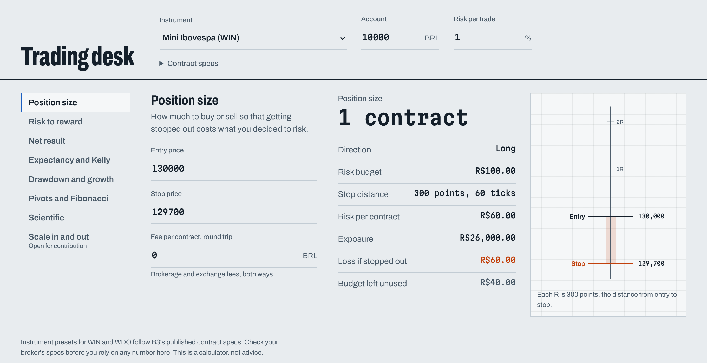

# Trading desk

Calculators for day and swing traders, in plain HTML, CSS and JavaScript. No build step, no framework, no runtime dependencies.



Set your instrument, account and risk per trade once at the top. Every tool reads them.

## Tools

| Tool | What it answers |
|---|---|
| Position size | How many contracts, lots or shares keep a stop-out inside your risk budget, fees included |
| Risk to reward | The ratio, the break-even win rate, and the 1R, 2R and 3R prices |
| Net result | What a closed trade made after fees and slippage |
| Expectancy and Kelly | What the average trade is worth, and the Kelly fraction |
| Drawdown and growth | The gain needed to recover a loss, losing streaks, and compounding |
| Pivots and Fibonacci | Pivot points from high, low and close, and retracements and extensions from a swing |
| Scientific | A calculator with its own expression parser (no `eval`) and history |
| Scale in and out | **Open for contribution.** See [CONTRIBUTING.md](CONTRIBUTING.md) |

Position size, Risk to reward and Net result draw a **trade ruler**: a price ladder with stop, entry and target to scale, shaded by loss and gain, with R marks.

## Instruments

Presets for B3 futures (WIN, WDO), US futures (ES, MES, NQ, MNQ), EUR/USD, gold, stocks in BRL and USD, Bitcoin, and a custom instrument.

WIN (R$ 0.20 per point, 5-point tick) and WDO (US$ 10,000 contract, R$ 0.50 tick per US$ 1,000, so R$ 5.00 per tick) follow B3's published contract specs. The other presets are common defaults. Brokers differ, so open **Contract specs** on the desk and edit the point value, tick size or smallest size. Your edits are saved in your browser.

## Run

Open `index.html` in a browser. No server needed.

Numbers and currencies are formatted for your browser's language, so a Brazilian browser shows `R$ 1.234,56`.

## Test

Needs Node 18 or newer.

```bash
npm test            # trading math, presets, tools and ruler layout
npm install         # once, for the interface check
npm run test:ui     # drives the real page in a simulated browser
```

## Put it online with GitHub Pages

Repository **Settings → Pages → Build and deployment**, choose **Deploy from a branch**, branch `main`, folder `/ (root)`, then Save. The page appears at `https://<your-username>.github.io/Calculator/` after a minute or two.

## How it is organized

```
index.html          page shell
css/style.css       all styling
js/trading.js       the math: pure functions, no DOM
js/instruments.js   instrument presets
js/fields.js        form logic shared by the tools
js/ruler.js         ruler layout (testable) and SVG drawing
js/expression.js    expression parser for the Scientific tool
js/tools/           one file per tool
js/app.js           the interface
test/               unit tests, run with node --test
e2e/                interface check
```

A tool is a small object: its `fields`, and a `compute(values, desk)` that returns a headline, rows and optionally a ruler. Adding one means adding a file in `js/tools/` and a `<script>` line in `index.html`.

## Disclaimer

This is a calculator, not financial advice. Check every number against your broker's specs before you trade.

## License

MIT. The bundled fonts, Archivo and Martian Mono, use the SIL Open Font License; see `fonts/`.
